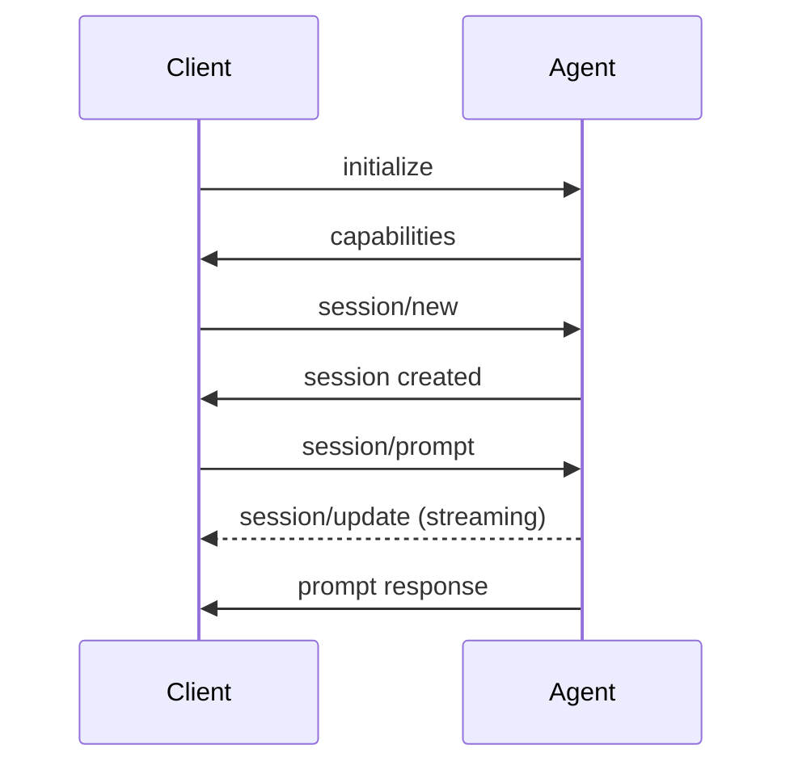

# 开发自定义 ACP 代理

本指南介绍如何开发自己的 ACP (Agent Client Protocol) 代理，使其能够在 AutoDev 和其他支持 ACP 的客户端中使用。

## ACP 协议概述

### 协议规范

ACP 使用 JSON-RPC 2.0 通过标准输入/输出 (stdio) 进行通信：

```
Client (IDE)         Agent (AI)
    ↓                    ↑
  stdin  ←──────────→  stdout
    ↑                    ↓
  stdout ←──────────→  stderr (logs)
```

### 核心消息流程



## 快速开始

### 环境准备

选择你喜欢的编程语言：

- **Kotlin/Java**: 使用 `autodev-acp-java`
- **TypeScript/Node.js**: 使用 `@autodev/acp-node`
- **Python**: 使用 `autodev-acp-python`
- **Rust**: 使用 `autodev-acp-rust`

### 示例：最小 ACP 代理

#### Kotlin 实现

```kotlin
import com.agentclientprotocol.server.*
import com.agentclientprotocol.model.*
import kotlinx.coroutines.flow.Flow
import kotlinx.coroutines.flow.flow

class MyAcpAgent : AcpServer {
    override suspend fun initialize(
        clientInfo: ClientInfo
    ): InitializeResponse {
        return InitializeResponse(
            protocolVersion = 1,
            agentCapabilities = AgentCapabilities(
                promptCapabilities = PromptCapabilities(
                    embeddedContext = true
                )
            ),
            agentInfo = AgentInfo(
                name = "My Custom Agent",
                version = "1.0.0"
            )
        )
    }

    override suspend fun createSession(
        params: SessionCreationParameters
    ): Flow<SessionEvent> = flow {
        val sessionId = SessionId("session-${System.currentTimeMillis()}")
        
        emit(SessionEvent.Created(
            AcpCreatedSessionResponse(
                sessionId = sessionId,
                _meta = JsonNull
            )
        ))
    }

    override suspend fun prompt(
        sessionId: SessionId,
        content: List<ContentBlock>
    ): Flow<PromptEvent> = flow {
        // 提取用户消息
        val userMessage = content
            .filterIsInstance<ContentBlock.Text>()
            .joinToString(" ") { it.text }

        // 发送思考过程
        emit(PromptEvent.SessionUpdate(
            SessionUpdate.AgentThoughtChunk("Analyzing your request...")
        ))

        // 调用 AI 模型（示例）
        val response = callAIModel(userMessage)

        // 发送响应
        emit(PromptEvent.SessionUpdate(
            SessionUpdate.AgentMessageChunk(
                ContentBlock.Text(response, Annotations(), JsonNull)
            )
        ))

        // 完成
        emit(PromptEvent.Response(
            AcpPromptResponse(
                stopReason = StopReason.END,
                _meta = JsonNull
            )
        ))
    }

    private suspend fun callAIModel(prompt: String): String {
        // 实现你的 AI 调用逻辑
        return "Response to: $prompt"
    }
}

fun main() {
    val server = MyAcpAgent()
    val transport = StdioTransport()
    val protocol = Protocol(transport)
    
    protocol.start(server)
}
```

#### TypeScript 实现

```typescript
import { AcpServer, Protocol, StdioTransport } from '@autodev/acp-node';

class MyAcpAgent implements AcpServer {
  async initialize(clientInfo) {
    return {
      protocolVersion: 1,
      agentCapabilities: {
        promptCapabilities: {
          embeddedContext: true
        }
      },
      agentInfo: {
        name: 'My Custom Agent',
        version: '1.0.0'
      }
    };
  }

  async *createSession(params) {
    const sessionId = `session-${Date.now()}`;
    
    yield {
      type: 'created',
      sessionId
    };
  }

  async *prompt(sessionId, content) {
    const userMessage = content
      .filter(block => block.type === 'text')
      .map(block => block.text)
      .join(' ');

    // 发送思考
    yield {
      type: 'session_update',
      update: {
        type: 'agent_thought_chunk',
        thought: 'Processing your request...'
      }
    };

    // 调用 AI
    const response = await this.callAI(userMessage);

    // 发送响应
    yield {
      type: 'session_update',
      update: {
        type: 'agent_message_chunk',
        content: { type: 'text', text: response }
      }
    };

    // 完成
    yield {
      type: 'response',
      stopReason: 'end'
    };
  }

  private async callAI(prompt: string): Promise<string> {
    // 实现 AI 调用
    return `Response to: ${prompt}`;
  }
}

// 启动服务器
const agent = new MyAcpAgent();
const transport = new StdioTransport();
const protocol = new Protocol(transport);

protocol.start(agent);
```

#### Python 实现

```python
import asyncio
from autodev_acp import AcpServer, Protocol, StdioTransport

class MyAcpAgent(AcpServer):
    async def initialize(self, client_info):
        return {
            'protocolVersion': 1,
            'agentCapabilities': {
                'promptCapabilities': {
                    'embeddedContext': True
                }
            },
            'agentInfo': {
                'name': 'My Custom Agent',
                'version': '1.0.0'
            }
        }

    async def create_session(self, params):
        session_id = f"session-{int(time.time())}"
        
        yield {
            'type': 'created',
            'sessionId': session_id
        }

    async def prompt(self, session_id, content):
        user_message = ' '.join(
            block['text'] for block in content 
            if block['type'] == 'text'
        )

        # 发送思考
        yield {
            'type': 'session_update',
            'update': {
                'type': 'agent_thought_chunk',
                'thought': 'Analyzing...'
            }
        }

        # 调用 AI
        response = await self.call_ai(user_message)

        # 发送响应
        yield {
            'type': 'session_update',
            'update': {
                'type': 'agent_message_chunk',
                'content': {'type': 'text', 'text': response}
            }
        }

        # 完成
        yield {
            'type': 'response',
            'stopReason': 'end'
        }

    async def call_ai(self, prompt: str) -> str:
        # 实现 AI 调用
        return f"Response to: {prompt}"

# 启动
async def main():
    agent = MyAcpAgent()
    transport = StdioTransport()
    protocol = Protocol(transport)
    await protocol.start(agent)

if __name__ == '__main__':
    asyncio.run(main())
```

## 实现关键功能

### 1. 文件系统访问

代理可以读取和写入文件：

```kotlin
class FileAwareAgent : AcpServer {
    override suspend fun prompt(
        sessionId: SessionId,
        content: List<ContentBlock>
    ): Flow<PromptEvent> = flow {
        // 请求读取文件
        emit(PromptEvent.SessionUpdate(
            SessionUpdate.ToolCall(
                id = ToolCallId("read-1"),
                title = "Reading file",
                tool = Tool.ReadTextFile(
                    path = "src/main/kotlin/Main.kt",
                    _meta = JsonNull
                ),
                status = ToolCallStatus.IN_PROGRESS
            )
        ))

        // 等待客户端提供文件内容
        val fileContent = waitForFileContent()

        // 处理文件内容
        emit(PromptEvent.SessionUpdate(
            SessionUpdate.AgentMessageChunk(
                ContentBlock.Text(
                    "File contains ${fileContent.lines().size} lines",
                    Annotations(),
                    JsonNull
                )
            )
        ))
    }
}
```

### 2. 执行终端命令

```kotlin
suspend fun executeCommand(command: String): Flow<PromptEvent> = flow {
    emit(PromptEvent.SessionUpdate(
        SessionUpdate.ToolCall(
            id = ToolCallId("cmd-1"),
            title = "Running: $command",
            tool = Tool.RunTerminalCommand(
                command = command,
                _meta = JsonNull
            ),
            status = ToolCallStatus.IN_PROGRESS
        )
    ))

    // 处理命令输出
    val output = waitForCommandOutput()
    
    emit(PromptEvent.SessionUpdate(
        SessionUpdate.ToolCallUpdate(
            id = ToolCallId("cmd-1"),
            title = "Command completed",
            status = ToolCallStatus.COMPLETED,
            result = ToolCallResult.TerminalCommand(
                output = output,
                exitCode = 0
            )
        )
    ))
}
```

### 3. 权限请求

```kotlin
suspend fun requestPermission(
    operation: String
): Flow<PromptEvent> = flow {
    emit(PromptEvent.SessionUpdate(
        SessionUpdate.ToolCallUpdate(
            id = ToolCallId("perm-1"),
            title = "Request permission to $operation",
            status = ToolCallStatus.PERMISSION_REQUIRED,
            permissionOptions = listOf(
                PermissionOption(
                    optionId = PermissionOptionId("allow-once"),
                    kind = PermissionOptionKind.ALLOW_ONCE,
                    name = "Allow Once",
                    description = "Allow this operation once"
                ),
                PermissionOption(
                    optionId = PermissionOptionId("allow-always"),
                    kind = PermissionOptionKind.ALLOW_ALWAYS,
                    name = "Allow Always",
                    description = "Always allow this type of operation"
                )
            )
        )
    ))

    // 等待用户选择
    val permission = waitForPermission()
    
    if (permission.approved) {
        // 执行操作
    } else {
        // 取消操作
    }
}
```

### 4. MCP 工具调用

```kotlin
suspend fun useMcpTool(
    serverName: String,
    toolName: String,
    arguments: Map<String, Any>
): Flow<PromptEvent> = flow {
    emit(PromptEvent.SessionUpdate(
        SessionUpdate.ToolCall(
            id = ToolCallId("mcp-1"),
            title = "Calling MCP tool: $toolName",
            tool = Tool.McpTool(
                server = serverName,
                tool = toolName,
                arguments = arguments,
                _meta = JsonNull
            ),
            status = ToolCallStatus.IN_PROGRESS
        )
    ))

    // 等待 MCP 响应
    val result = waitForMcpResult()
    
    emit(PromptEvent.SessionUpdate(
        SessionUpdate.ToolCallUpdate(
            id = ToolCallId("mcp-1"),
            status = ToolCallStatus.COMPLETED,
            result = result
        )
    ))
}
```

## 高级特性

### 1. 流式思考过程

展示代理的思考过程：

```kotlin
suspend fun thinkingProcess(query: String): Flow<PromptEvent> = flow {
    emit(PromptEvent.SessionUpdate(
        SessionUpdate.AgentThoughtChunk("Analyzing query...")
    ))

    delay(500)

    emit(PromptEvent.SessionUpdate(
        SessionUpdate.AgentThoughtChunk("Searching codebase...")
    ))

    delay(500)

    emit(PromptEvent.SessionUpdate(
        SessionUpdate.AgentThoughtChunk("Generating response...")
    ))
}
```

### 2. 计划生成

```kotlin
suspend fun generatePlan(task: String): Flow<PromptEvent> = flow {
    val plan = Plan(
        entries = listOf(
            PlanEntry(
                id = PlanEntryId("1"),
                content = "Analyze requirements",
                status = PlanEntryStatus.COMPLETED
            ),
            PlanEntry(
                id = PlanEntryId("2"),
                content = "Design solution",
                status = PlanEntryStatus.IN_PROGRESS
            ),
            PlanEntry(
                id = PlanEntryId("3"),
                content = "Implement code",
                status = PlanEntryStatus.PENDING
            )
        )
    )

    emit(PromptEvent.SessionUpdate(
        SessionUpdate.PlanUpdate(plan.entries)
    ))
}
```

### 3. 上下文管理

```kotlin
class ContextAwareAgent : AcpServer {
    private val sessionContexts = mutableMapOf<SessionId, SessionContext>()

    data class SessionContext(
        val cwd: String,
        val conversationHistory: MutableList<Message>,
        val fileCache: MutableMap<String, String>
    )

    override suspend fun createSession(
        params: SessionCreationParameters
    ): Flow<SessionEvent> = flow {
        val sessionId = SessionId(UUID.randomUUID().toString())
        
        sessionContexts[sessionId] = SessionContext(
            cwd = params.cwd,
            conversationHistory = mutableListOf(),
            fileCache = mutableMapOf()
        )

        emit(SessionEvent.Created(
            AcpCreatedSessionResponse(sessionId, JsonNull)
        ))
    }

    override suspend fun prompt(
        sessionId: SessionId,
        content: List<ContentBlock>
    ): Flow<PromptEvent> = flow {
        val context = sessionContexts[sessionId] ?: error("Session not found")
        
        // 使用上下文生成响应
        context.conversationHistory.add(Message(content))
        
        // ...生成响应...
    }
}
```

## 集成 AI 模型

### OpenAI

```kotlin
import com.openai.client.OpenAIClient
import com.openai.models.*

class OpenAIAgent(private val apiKey: String) : AcpServer {
    private val client = OpenAIClient(apiKey)

    override suspend fun prompt(
        sessionId: SessionId,
        content: List<ContentBlock>
    ): Flow<PromptEvent> = flow {
        val messages = buildMessages(content)

        val stream = client.chat.completions.create(
            ChatCompletionCreateParams.builder()
                .model("gpt-4")
                .messages(messages)
                .stream(true)
                .build()
        )

        stream.collect { chunk ->
            chunk.choices.firstOrNull()?.delta?.content?.let { content ->
                emit(PromptEvent.SessionUpdate(
                    SessionUpdate.AgentMessageChunk(
                        ContentBlock.Text(content, Annotations(), JsonNull)
                    )
                ))
            }
        }
    }
}
```

### Anthropic Claude

```kotlin
import com.anthropic.client.AnthropicClient
import com.anthropic.models.*

class ClaudeAgent(private val apiKey: String) : AcpServer {
    private val client = AnthropicClient(apiKey)

    override suspend fun prompt(
        sessionId: SessionId,
        content: List<ContentBlock>
    ): Flow<PromptEvent> = flow {
        val stream = client.messages.stream(
            MessageCreateParams.builder()
                .model("claude-sonnet-4")
                .messages(buildMessages(content))
                .maxTokens(4096)
                .build()
        )

        stream.collect { event ->
            when (event) {
                is MessageStreamEvent.ContentBlockDelta -> {
                    emit(PromptEvent.SessionUpdate(
                        SessionUpdate.AgentMessageChunk(
                            ContentBlock.Text(
                                event.delta.text,
                                Annotations(),
                                JsonNull
                            )
                        )
                    ))
                }
            }
        }
    }
}
```

## 打包和分发

### 创建可执行文件

#### Kotlin (Gradle)

```kotlin
// build.gradle.kts
plugins {
    application
    id("com.github.johnrengelman.shadow") version "8.1.1"
}

application {
    mainClass.set("com.example.MyAcpAgentKt")
}

tasks.shadowJar {
    archiveFileName.set("my-acp-agent.jar")
}
```

构建：

```bash
./gradlew shadowJar

# 运行
java -jar build/libs/my-acp-agent.jar
```

#### TypeScript (npm)

```json
{
  "name": "my-acp-agent",
  "version": "1.0.0",
  "bin": {
    "my-agent": "./dist/index.js"
  },
  "scripts": {
    "build": "tsc",
    "start": "node dist/index.js"
  }
}
```

发布：

```bash
npm run build
npm publish

# 使用
npx my-acp-agent
```

#### Python (Poetry)

```toml
[tool.poetry.scripts]
my-agent = "my_acp_agent.main:main"
```

发布：

```bash
poetry build
poetry publish

# 使用
pip install my-acp-agent
my-agent
```

### 配置文件

创建 `acp-agent.json`：

```json
{
  "name": "My Custom Agent",
  "version": "1.0.0",
  "description": "A custom ACP agent for...",
  "author": "Your Name",
  "homepage": "https://github.com/you/my-agent",
  "executable": {
    "command": "my-agent",
    "args": ["acp"],
    "env": {}
  },
  "capabilities": {
    "filesystem": true,
    "terminal": true,
    "mcp": true
  }
}
```

## 测试

### 单元测试

```kotlin
class MyAcpAgentTest {
    @Test
    fun `test initialize`() = runBlocking {
        val agent = MyAcpAgent()
        val response = agent.initialize(
            ClientInfo(
                protocolVersion = 1,
                capabilities = ClientCapabilities(),
                implementation = Implementation("test", "1.0", "Test")
            )
        )

        assertEquals(1, response.protocolVersion)
        assertEquals("My Custom Agent", response.agentInfo.name)
    }

    @Test
    fun `test prompt`() = runBlocking {
        val agent = MyAcpAgent()
        val sessionId = SessionId("test-session")

        val events = agent.prompt(
            sessionId,
            listOf(ContentBlock.Text("Hello", Annotations(), JsonNull))
        ).toList()

        assertTrue(events.any { it is PromptEvent.SessionUpdate })
        assertTrue(events.any { it is PromptEvent.Response })
    }
}
```

### 集成测试

使用 AutoDev 测试客户端：

```bash
# 安装测试工具
npm install -g @autodev/acp-test

# 运行测试
acp-test my-agent acp
```

### 手动测试

```bash
# 测试 initialize
echo '{"jsonrpc":"2.0","id":1,"method":"initialize","params":{"protocolVersion":1}}' | my-agent acp

# 测试 session/new
echo '{"jsonrpc":"2.0","id":2,"method":"session/new","params":{"cwd":"."}}' | my-agent acp
```

## 部署

### 本地安装

```bash
# 添加到 PATH
export PATH=$PATH:/path/to/my-agent

# 或创建符号链接
ln -s /path/to/my-agent /usr/local/bin/my-agent
```

### Docker 容器

```dockerfile
FROM openjdk:17-slim
COPY my-acp-agent.jar /app/agent.jar
ENTRYPOINT ["java", "-jar", "/app/agent.jar"]
```

### 云服务

通过 Bridge 暴露：

```yaml
# bridge-config.yaml
agents:
  my-agent:
    type: "subprocess"
    command: "/path/to/my-agent"
    args: ["acp"]
    port: 8080
```

## 最佳实践

1. **错误处理**: 优雅处理所有异常
2. **日志记录**: 使用 stderr 输出日志
3. **性能优化**: 使用流式响应，避免阻塞
4. **文档完善**: 提供详细的使用说明
5. **版本管理**: 遵循语义化版本
6. **测试覆盖**: 充分的单元和集成测试

## 参考资源

- [ACP 协议规范](https://github.com/agent-client-protocol/spec)
- [AutoDev ACP 实现](https://github.com/phodal/xiuper)
- [示例代理仓库](https://github.com/autodev-ai/acp-examples)
